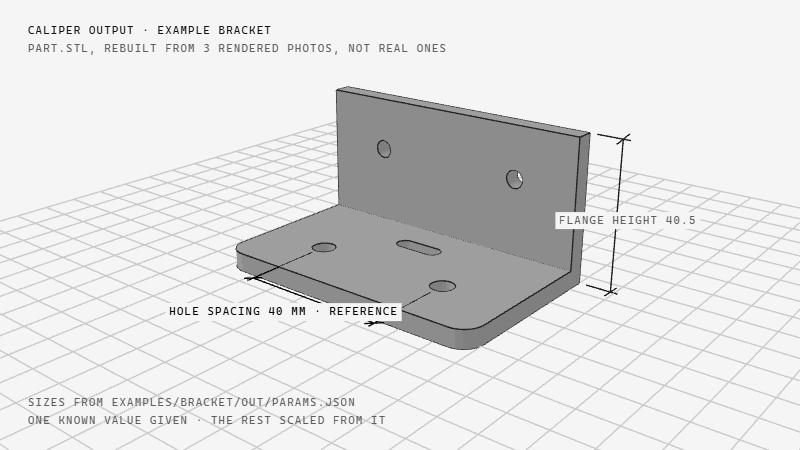

<picture>
  <source media="(max-width: 600px) and (prefers-color-scheme: dark)" srcset=".github/assets/hero-mobile-dark.svg">
  <source media="(max-width: 600px)" srcset=".github/assets/hero-mobile-light.svg">
  <source media="(prefers-color-scheme: dark)" srcset=".github/assets/hero-dark.svg">
  
</picture>

<picture>
  <source media="(max-width: 600px) and (prefers-color-scheme: dark)" srcset=".github/assets/rule-mobile-01-dark.svg">
  <source media="(max-width: 600px)" srcset=".github/assets/rule-mobile-01-light.svg">
  <source media="(prefers-color-scheme: dark)" srcset=".github/assets/rule-01-dark.svg">
  
</picture>

Caliper turns 1 to 4 photos of a simple part, such as a bracket or a plate, into a CAD model with real
dimensions. You give it one measurement you already know, for example "hole spacing 40mm", and it scales
everything else from that. You get a STEP file, an STL for printing, and a parameter file you can edit
and rebuild from.

It is an early prototype. It has been measured on one part, from rendered photos. It has not been
tested on real photos.

<picture>
  <source media="(max-width: 600px) and (prefers-color-scheme: dark)" srcset=".github/assets/rule-mobile-02-dark.svg">
  <source media="(max-width: 600px)" srcset=".github/assets/rule-mobile-02-light.svg">
  <source media="(prefers-color-scheme: dark)" srcset=".github/assets/rule-02-dark.svg">
  
</picture>

**The problem.** A 3D scan gives you a mesh: many triangles that look like the part and know nothing
about it. You cannot make a hole 0.5 mm bigger, move it, or thicken a wall without fighting the mesh.

**What was missing.** The design intent: a plate of 80 by 50 by 5 mm, two 6.5 mm holes 40 mm apart, a
flange on one edge. That is a short list of features with numbers on them, which is what a CAD model is.
Caliper recovers that list from photos, writes it as readable CadQuery code and exports the solid.

**Who it is for.** People who need to redraw, change or reprint a simple prismatic part that has no
drawing, and who can measure one dimension of it by hand.

<picture>
  <source media="(max-width: 600px) and (prefers-color-scheme: dark)" srcset=".github/assets/rule-mobile-03-dark.svg">
  <source media="(max-width: 600px)" srcset=".github/assets/rule-mobile-03-light.svg">
  <source media="(prefers-color-scheme: dark)" srcset=".github/assets/rule-03-dark.svg">
  
</picture>

<picture>
  <source media="(max-width: 600px) and (prefers-color-scheme: dark)" srcset=".github/assets/flow-mobile-dark.svg">
  <source media="(max-width: 600px)" srcset=".github/assets/flow-mobile-light.svg">
  <source media="(prefers-color-scheme: dark)" srcset=".github/assets/flow-dark.svg">
  
</picture>

1. **Photos.** One to four images in a folder. The file name says the view: `top`, `side`, `front`
   (also `plan`, `profile`, `elevation` and similar). Unnamed photos take the remaining views in order.
2. **Reference.** One known measurement in plain text: hole spacing, hole diameter, length, width,
   thickness, flange height, or the side of a printed ArUco marker. Units mm, cm, m or inches.
3. **Measure.** OpenCV separates the part from the background and reads the face square to the camera.
   The reference sets millimetres per pixel in the view that shows it. That scale is passed to the other
   views through a dimension they share: plate length for top and front, plate width for top and side.
4. **Describe.** The classical describer turns the measurements into a feature tree: base plate, corner
   fillet, one flange, holes and slots. It runs offline. With `ANTHROPIC_API_KEY` set, the default
   `auto` mode asks Claude (`claude-fable-5-2`, vision with a JSON schema) for the tree instead, and
   passes the classical measurements along as evidence.
5. **Snap.** Dimensions within 0.35 of a step of a 0.5 mm grid are rounded to it, and nearly mirrored
   hole pairs are made exactly symmetric. The raw values stay in `measured.json`.
6. **Build.** The tree becomes `model.py`, CadQuery code in which every dimension is looked up by name in
   `params.json`. The solid is exported to `part.step` and `part.stl`.
7. **Check.** Walls, webs and edge margins are read from the tree and compared with a minimum wall
   (default 1.2 mm). Unsupported overhang area is measured on the mesh for six print orientations.
   Results go to `report.md` and `report.json`, and a render to `preview.png`.

<picture>
  <source media="(prefers-color-scheme: dark)" srcset=".github/assets/scene-dark.gif">
  
</picture>

<sub>The solid is the committed scan output, [`examples/bracket/out/part.stl`](examples/bracket/out/part.stl), and the dimensions are values from its `params.json`. The photos it was rebuilt from are rendered, not real.</sub>

<picture>
  <source media="(max-width: 600px) and (prefers-color-scheme: dark)" srcset=".github/assets/rule-mobile-04-dark.svg">
  <source media="(max-width: 600px)" srcset=".github/assets/rule-mobile-04-light.svg">
  <source media="(prefers-color-scheme: dark)" srcset=".github/assets/rule-04-dark.svg">
  
</picture>

What the code does today.

- **CLI.** `caliper scan`, `caliper rebuild` (after editing `params.json`) and `caliper marker`
  (printable ArUco PNG). `caliper/cli.py`
- **Photo ingest.** 1 to 4 images, view from the file name, EXIF focal length read. `caliper/ingest.py`
- **Reference parsing and scale.** Seven reference kinds, unit conversion, pixel scale, scale chaining
  between views, ArUco marker detection. `caliper/calibration.py`
- **Classical measurement.** Face segmentation, skew correction, holes, slots, corner radii, L-profile
  from the side view. `caliper/measure.py`, `caliper/describe.py`
- **Claude describer.** Builds the request with photos, reference and measured values, and validates the
  structured answer into a feature tree. `caliper/vision.py`
- **Feature tree.** Base plate, fillet, flange, hole, slot, boss. Validation, JSON round trip, snapping.
  `caliper/features.py`
- **CadQuery generation and export.** Readable `model.py`, STEP and STL. `caliper/codegen.py`,
  `caliper/export.py`
- **Print check.** Minimum wall per feature, webs between holes, overhang per orientation.
  `caliper/dfm.py`
- **Preview render.** Offscreen VTK render of the mesh. `caliper/render.py`
- **Tests.** 57 tests: calibration math, code generation checked against hand-computed volumes, print
  check, measurement on drawn images, the Claude request shape against a stub client, and the bracket
  example end to end. `tests/`

Measured on one synthetic part. [`examples/bracket`](examples/bracket) renders three photos of a
hand-written CadQuery bracket with a pinhole camera, slight tilt, blur, noise and JPEG compression, runs
the classical describer on them and compares with the true dimensions
([`accuracy.md`](examples/bracket/accuracy.md)):

| Measure | Result |
|---|---|
| Dimensions scored (reference excluded) | 14 |
| Mean absolute error | 0.09 mm (0.67%) |
| Worst error | 0.47 mm, flange height 40 read as 40.47 |
| Exact after snapping to 0.5 mm | 12 of 14 |
| Real photos tested | 0 |
| Claude describer tested against the live API | No, only against a stub client |

The model it produced is in [`examples/bracket/out/`](examples/bracket/out), with its render in
[`preview.png`](examples/bracket/out/preview.png).

Known limits:

- Simple prismatic parts only. No curved surfaces, threads, snap fits, ribs, chamfers, pockets,
  countersinks or blind holes. At most one flange and one corner fillet.
- The classical describer needs a top view and clean photos: plain background, even light, square-on.
  It never detects bosses; a boss can only come from the Claude describer or a hand-edited tree.
- Snapping can make a value worse: in the example the 40 mm flange became 40.5 and the 5.2 mm flange
  holes became 5.0. `--snap 0` turns it off.
- A marker gives the scale of the surface it lies on. The correction to the part's top face is not
  applied; the EXIF focal length is read but not used.
- Anything no photo shows is not in the model.
- The print check is a first pass, not a slicer.

<picture>
  <source media="(max-width: 600px) and (prefers-color-scheme: dark)" srcset=".github/assets/rule-mobile-05-dark.svg">
  <source media="(max-width: 600px)" srcset=".github/assets/rule-mobile-05-light.svg">
  <source media="(prefers-color-scheme: dark)" srcset=".github/assets/rule-05-dark.svg">
  
</picture>

Requires Python 3.11 or newer; CadQuery must have a wheel for your Python version. The commands below
were run on Windows 11 with Python 3.11.18, a virtual environment made with
[uv](https://docs.astral.sh/uv/), and no API key. The install pulls the OpenCascade kernel and VTK and
took about 100 seconds. On Windows, keep the environment path short: the CAD kernel's native libraries
can fail to load from very long paths. Here the environment sat at a short path outside the clone
instead of `.venv`; the commands were otherwise the same. On macOS or Linux use `.venv/bin/` instead of `.venv/Scripts/`;
that was not tested.

```bash
git clone https://github.com/hesselb20-ctrl/caliper.git
cd caliper
uv venv --python 3.11 --seed .venv
.venv/Scripts/python -m pip install -e ".[dev]"
```

Run the tests. Expect `57 passed`.

```bash
.venv/Scripts/python -m pytest -q
```

Scan the example photos. With no API key it uses the classical describer and says so.

```bash
.venv/Scripts/caliper scan examples/bracket/photos --ref "hole spacing 40mm" --out part
```

```text
Feature tree (classical):
  base [base_plate] length=80, width=50, thickness=5
    fillet [fillet] radius=6, corners=free
    flange [flange] height=40.5, thickness=5, edge=+y
      fh1 [hole] u=-22, v=26, diameter=5
      fh2 [hole] u=22, v=26, diameter=5
    h1 [hole] x=-20, y=-8, diameter=6.5
    h2 [hole] x=20, y=-8, diameter=6.5
    slot1 [slot] x=0, y=8, length=14, width=5, angle=0

Manufacturability:
  thinnest wall: 5.00 mm (base thickness) - ok
  best print orientation: +z up (as modelled), 39.9 mm2 of unsupported overhang
  warning: ANTHROPIC_API_KEY not set: used the offline classical describer
```

`part/` then holds `part.step`, `part.stl`, `params.json`, `model.py`, `feature_tree.json`,
`measured.json`, `calibration.json`, `report.md`, `report.json` and `preview.png`.

Edit a number in `part/params.json` and rebuild. Changing `"flange.height"` from 40.5 to 40 gave
`flange [flange] height=40` in the rebuilt tree.

```bash
.venv/Scripts/caliper rebuild part
```

Write a printable ArUco marker. Print it, measure the black square, and pass `--ref "marker 30mm"`
with the size you measured.

```bash
.venv/Scripts/caliper marker --out marker.png
```

Re-run the accuracy benchmark. It re-renders the photos and rewrites `examples/bracket/out/` and
`accuracy.md`. The run here gave 0.092 mm mean error, the same within rounding as the committed table.

```bash
.venv/Scripts/python examples/bracket/run_example.py
```

Other scan options: `--describer auto|claude|classical`, `--snap 0.5`, `--min-wall 1.2`,
`--max-overhang 45`, `--no-preview`. The Claude describer (`--describer claude`, or `auto` with
`ANTHROPIC_API_KEY` set) was not run here.

<picture>
  <source media="(max-width: 600px) and (prefers-color-scheme: dark)" srcset=".github/assets/rule-mobile-06-dark.svg">
  <source media="(max-width: 600px)" srcset=".github/assets/rule-mobile-06-light.svg">
  <source media="(prefers-color-scheme: dark)" srcset=".github/assets/rule-06-dark.svg">
  
</picture>

**Stack**

| Layer | Built with |
|---|---|
| CLI and pipeline | Python 3.11+, argparse |
| Measurement | OpenCV (contrib, for ArUco), NumPy, Pillow |
| Optional describer | Anthropic Python SDK, Claude vision with structured output |
| CAD kernel and export | CadQuery (OpenCascade) |
| Preview render | VTK, offscreen |
| Tests | pytest |
| Tutorial video | Remotion, ffmpeg |

**Status**

| Part | State |
|---|---|
| Classical pipeline | Built. Measured on one rendered bracket. Never run on real photos. |
| Claude describer | Built. Request and response handling tested against a stub. Never run against the live API in this repository. |
| CadQuery generation, export, print check | Built and unit tested. |
| Packaging | Version 0.1.0. Not on PyPI. No CI. |

**Roadmap.** From the repository's previous README:

1. A real-photo benchmark with a handful of printed and measured parts.
2. Measured accuracy for the Claude describer, with and without pixel evidence.
3. Chamfers, countersinks, pockets, ribs and U-channels.
4. Lens distortion and full perspective correction from the ArUco marker.
5. A confidence value per dimension, and a prompt for the one extra photo that would help most.
6. 3MF export and print-orientation hints for the slicer.

**Documents**

| File | Contents |
|---|---|
| [`examples/bracket/accuracy.md`](examples/bracket/accuracy.md) | Per-dimension results of the synthetic benchmark |
| [`examples/bracket/out/report.md`](examples/bracket/out/report.md) | Scan report: scale per view, measured and snapped values, print check |
| [`tutorial/README.md`](tutorial/README.md) | How the tutorial video is built from the example's output |
| [`media/tutorial.mp4`](media/tutorial.mp4?raw=true) | 75-second walkthrough video, 4.8 MB download |

<picture>
  <source media="(max-width: 600px) and (prefers-color-scheme: dark)" srcset=".github/assets/rule-mobile-07-dark.svg">
  <source media="(max-width: 600px)" srcset=".github/assets/rule-mobile-07-light.svg">
  <source media="(prefers-color-scheme: dark)" srcset=".github/assets/rule-07-dark.svg">
  
</picture>

MIT. See [`LICENSE`](LICENSE).
