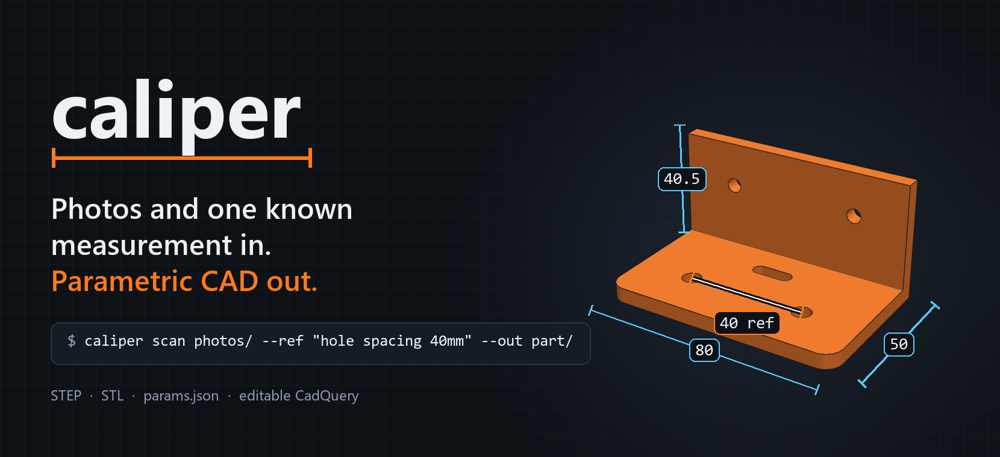
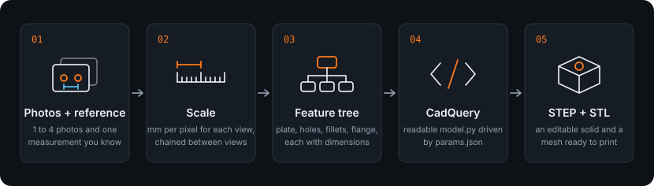
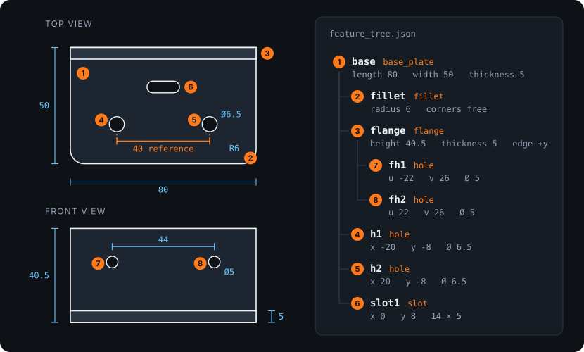
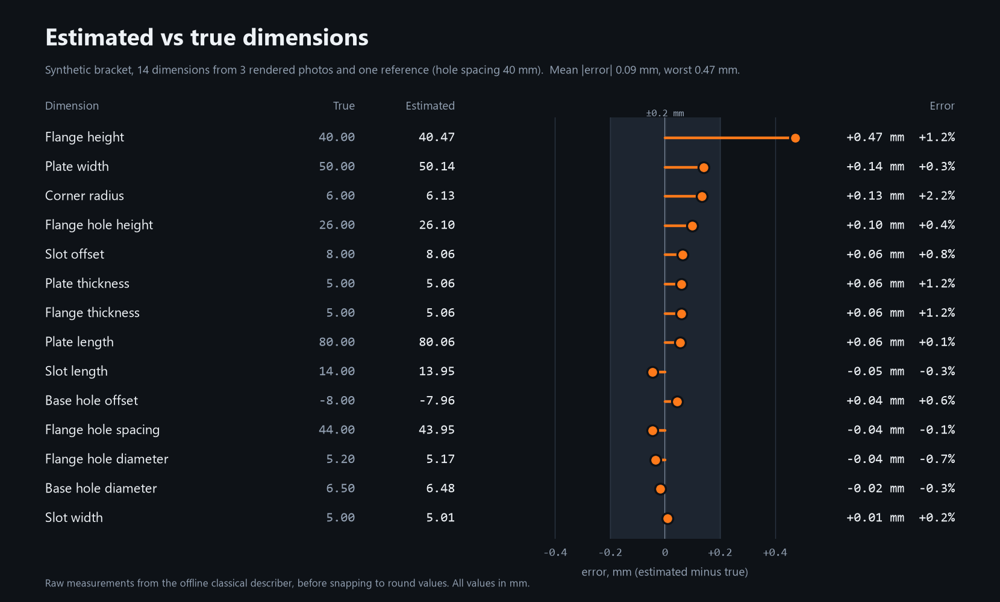

# caliper

**Photos and one known measurement in. Parametric CAD out.**



Caliper turns 1 to 4 photos of a simple physical part (a bracket, mount, clip or plate) plus one measurement you already know into a parametric CAD model with real dimensions. You get a STEP file, an STL that is ready to print, and a parameter file you can edit.

```bash
caliper scan photos/ --ref "hole spacing 40mm" --out part/
```

[](media/tutorial.mp4)

The full 75 second walkthrough is [media/tutorial.mp4](media/tutorial.mp4).

## Why

A 3D scan gives you a mesh: a million triangles that look like the part and know nothing about it. You cannot make the hole 0.5 mm bigger, move it, or thicken a wall without fighting the mesh.

What you want back is the *design intent*: a plate that is 80 by 50 by 5, two 6.5 mm holes 40 mm apart, a flange on one edge. That is a short list of features with numbers on them, and it is exactly what a CAD model is. Caliper recovers that list, writes it as readable CadQuery code, and exports the solid.

## How it works



1. **Photos + reference.** You shoot the part square-on from the top, the side and the front, and give one measurement you trust: `"hole spacing 40mm"`, `"width 50mm"`, or a printed ArUco marker (`"marker 30mm"`).
2. **Scale.** The reference fixes millimetres per pixel in the view that shows it. That scale is then chained to the other views through dimensions they share (the plate length is visible from above and from the front), so no view is scaled by guesswork. Only faces square to the camera are measured, which keeps perspective from stretching anything.
3. **Feature tree.** Claude (`claude-fable-5-2`, vision) describes the part as a tree of features: base plate, holes, slots, fillets, bosses, a flange, each with dimensions. The pixel measurements are handed to Claude as evidence, so it spends its judgement on structure and intent instead of guessing sizes. Without an API key, an offline classical describer builds the tree from the measurements alone.
4. **CadQuery.** The tree becomes a `model.py` you can read, with every dimension looked up by name in `params.json`.
5. **STEP + STL.** The solid is exported, checked for printability (minimum wall, overhangs per print orientation) and summarised in `report.md`.



## Install

Python 3.11 or newer.

```bash
pip install git+https://github.com/hesselb20-ctrl/caliper.git
```

Caliper is not on PyPI yet, so install it from GitHub. CadQuery brings the OpenCascade CAD kernel with it, so expect a large download.

To use the Claude describer, set an API key:

```bash
export ANTHROPIC_API_KEY=sk-ant-...
```

On Windows, install into a virtual environment with a short path (for example `C:\venvs\caliper`): the CAD kernel's DLLs fail to load from paths longer than 260 characters.

## Quickstart

Put your photos in a folder. Name them `top`, `side` and `front` so caliper knows which is which.

```bash
caliper scan photos/ --ref "hole spacing 40mm" --out part/
```

```text
Feature tree (classical):
  base [base_plate] length=80, width=50, thickness=5
    fillet [fillet] radius=6, corners=free
    flange [flange] height=40.5, thickness=5, edge=+y
      fh1 [hole] u=-22, v=26, diameter=5
      fh2 [hole] u=22, v=26, diameter=5
    h1 [hole] x=-20, y=-8, diameter=6.5
    h2 [hole] x=20, y=-8, diameter=6.5
    slot1 [slot] x=0, y=8, length=14, width=5, angle=0

Manufacturability:
  thinnest wall: 5.00 mm (base thickness) - ok
  best print orientation: +z up (as modelled), 39.9 mm2 of unsupported overhang
```

`part/` now holds:

| File | What it is |
|---|---|
| `part.step` | The solid, for any CAD package |
| `part.stl` | The mesh, ready for a slicer |
| `params.json` | Every dimension by name, e.g. `"flange.height": 40.5` |
| `model.py` | The generated CadQuery source |
| `feature_tree.json` | The feature tree |
| `measured.json` | Raw measurements before snapping to round values |
| `report.md` | Scale per view, measurements, print check |
| `preview.png` | A render of the result |

To change the part, edit a number in `params.json` and rebuild:

```bash
caliper rebuild part/
```

Useful options: `--describer claude|classical|auto`, `--snap 0.5` (snap dimensions to a grid in mm, `0` keeps raw measurements), `--min-wall 1.2`, `--max-overhang 45`. `caliper marker --out marker.png` writes a printable ArUco marker.

### Taking photos that work

- Plain background that contrasts with the part. A sheet of paper is fine.
- Shoot square-on, from arm's length or further, and zoom in instead of moving closer.
- Keep the light behind you, so the face you are shooting is the brightest surface.
- `top`: straight down. `side`: end-on, so you see the profile. `front`: looking at the inner face of the flange.

## Accuracy

The repository includes one benchmark, and it is synthetic: [examples/bracket](examples/bracket) renders three photos of a hand-written CadQuery bracket with known dimensions, runs caliper on them, and compares. The camera is a real pinhole at about 400 mm, tilted by about a degree and rolled by a couple, and the frames get blur, noise, vignetting and JPEG compression.



| Dimension | True (mm) | Measured (mm) | Error (mm) | Error | After snap (mm) |
|---|---:|---:|---:|---:|---:|
| Plate length | 80 | 80.06 | +0.06 | +0.1% | 80 |
| Plate width | 50 | 50.14 | +0.14 | +0.3% | 50 |
| Plate thickness | 5 | 5.06 | +0.06 | +1.2% | 5 |
| Corner radius | 6 | 6.13 | +0.13 | +2.2% | 6 |
| Base hole diameter | 6.5 | 6.48 | -0.02 | -0.3% | 6.5 |
| Base hole spacing * | 40 | 40.00 | +0.00 | +0.0% | 40 |
| Base hole offset | -8 | -7.96 | +0.04 | +0.6% | -8 |
| Slot length | 14 | 13.95 | -0.05 | -0.3% | 14 |
| Slot width | 5 | 5.01 | +0.01 | +0.2% | 5 |
| Slot offset | 8 | 8.06 | +0.06 | +0.8% | 8 |
| Flange height | 40 | 40.47 | +0.47 | +1.2% | 40.5 |
| Flange thickness | 5 | 5.06 | +0.06 | +1.2% | 5 |
| Flange hole diameter | 5.2 | 5.17 | -0.04 | -0.7% | 5 |
| Flange hole spacing | 44 | 43.95 | -0.04 | -0.1% | 44 |
| Flange hole height | 26 | 26.10 | +0.10 | +0.4% | 26 |

\* the reference measurement, so not scored.

Over the 14 scored dimensions the mean absolute error is **0.09 mm (0.67%)** and the worst is **0.47 mm** (flange height, 1.2%). The largest relative error is the corner radius at 2.2%.

What these numbers do and do not show:

- **They come from the offline classical describer.** The Claude describer is implemented and its request and response handling are unit tested against a stub, but it was not run against the live API for this benchmark, so there is no measured accuracy for it yet. Run `python examples/bracket/run_example.py --claude` with a key to produce one.
- **Snapping helps and hurts.** Snapping to a 0.5 mm grid made 12 of the 14 dimensions exact, and made two worse: the flange height became 40.5 (true 40) and the 5.2 mm flange holes became 5.0. `measured.json` always keeps the raw values, and `--snap 0` turns snapping off.
- **Rendered photos are easier than real ones.** There are no shadows, no lens distortion, no clutter and no glossy highlights. Expect real photos to do worse. There is no real-photo benchmark in the repository yet.
- **It is one part.** One bracket says little about other shapes.

Reproduce it:

```bash
python examples/bracket/run_example.py
```

## Supported part types

Version 1 handles simple prismatic parts built from these features:

| Feature | Parameters |
|---|---|
| Base plate | length, width, thickness |
| Corner fillet | radius, on all corners or only the free ones |
| Flange (one, on any edge) | height, thickness |
| Through hole | position, diameter; in the base or the flange |
| Through slot | position, length, width, angle |
| Round boss | position, diameter, height, optional bore |

That covers flat plates, L-brackets, simple mounts, adapter plates and spacers. Knobs and clips are only modelled as far as their prismatic envelope goes.

## Limitations

- **Simple prismatic parts only.** No curved or organic surfaces, threads, snap fits, ribs, gussets, chamfers, pockets, countersinks or blind holes.
- **One flange.** U-channels and boxes are out of scope for now.
- **The offline describer needs clean photos**: plain background, even light, square-on. It reads holes in the base from the top view and holes in the flange from the front view. Real-world photos are what the Claude describer is for.
- **Hidden features are invisible.** Anything no photo shows is not in the model. The describer's notes say what was assumed.
- **ArUco calibration is basic.** The marker gives the scale of the surface it lies on; the correction to the top face of the part is not applied automatically yet.
- **The print check is a first pass**, not a slicer: wall thicknesses come from the feature tree and overhangs from the mesh, for the six axis-aligned orientations.
- **Check critical dimensions with real calipers** before you rely on a fit.

## Roadmap

- A real-photo benchmark with a handful of printed and measured parts
- Measured accuracy for the Claude describer, with and without pixel evidence
- Chamfers, countersinks, pockets, ribs and U-channels
- Lens distortion and full perspective correction from the ArUco marker
- A confidence value per dimension, and a prompt for the one extra photo that would help most
- 3MF export and print-orientation hints for the slicer

## Development

```bash
git clone https://github.com/hesselb20-ctrl/caliper.git
cd caliper
pip install -e ".[dev]"
pytest
```

The tests cover the calibration math, feature tree to CadQuery generation (volumes and bounding boxes checked against hand calculations), the manufacturability check, measurement on drawn images, the Claude request shape, and the bracket example end to end.

The README images are made in code by `python scripts/make_media.py`, and the tutorial video is a Remotion project in [tutorial/](tutorial). Both read their colours and type sizes from `media/theme.json`.

## License

MIT. See [LICENSE](LICENSE).
